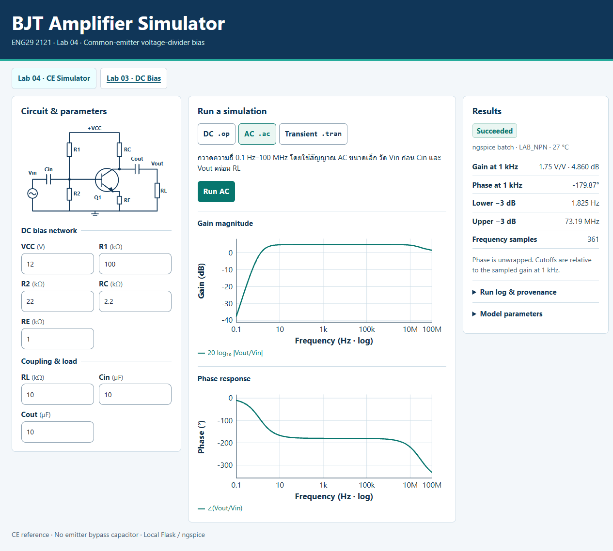
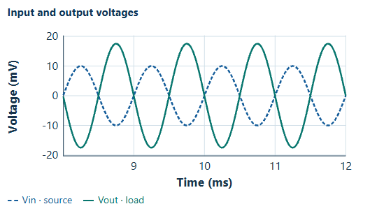
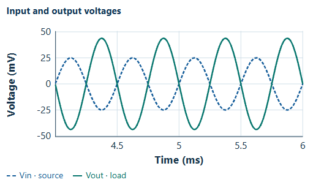
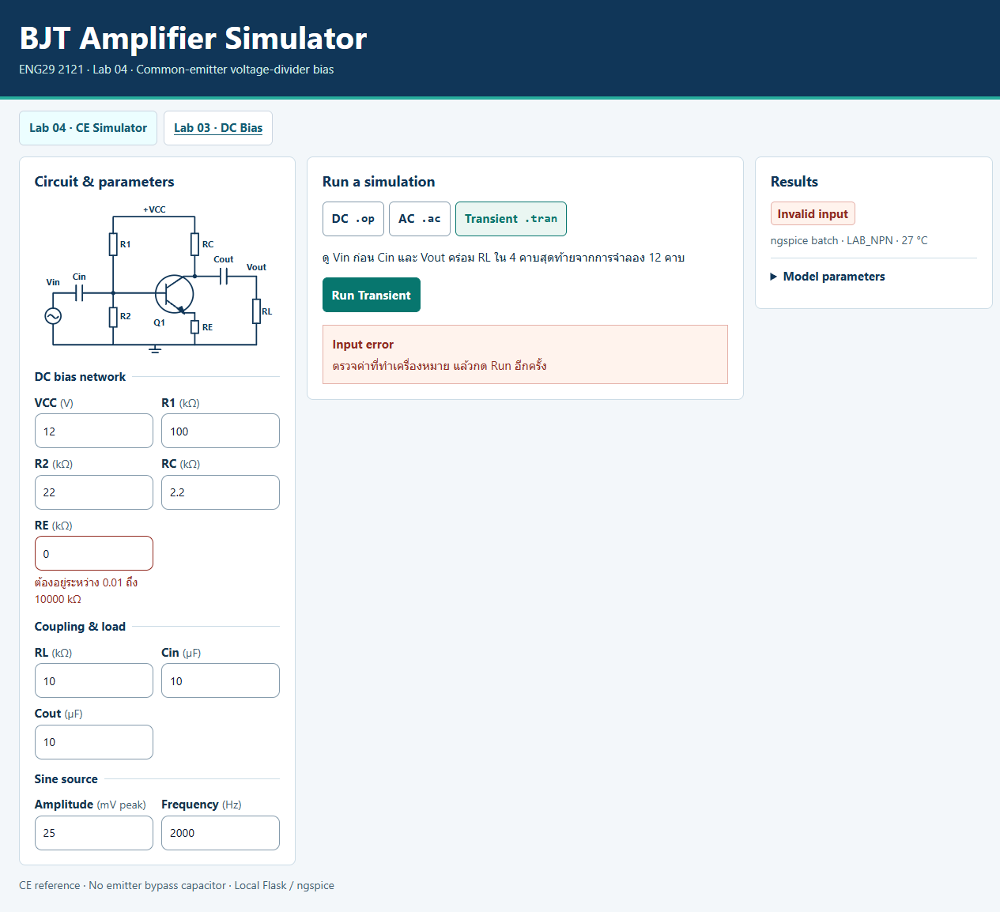
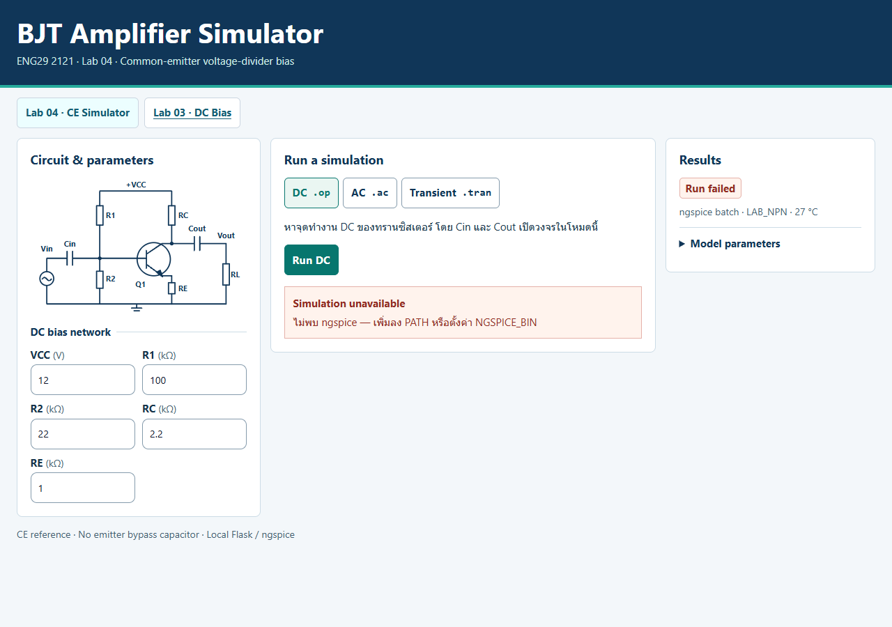
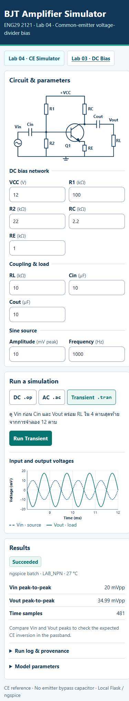

# Gitlab

## Lab 04 — BJT Common-Emitter Amplifier Simulator

Flask web app for one voltage-divider CE reference circuit: **DC** operating point
(`.op`), **AC** Bode magnitude and phase (`.ac`), and **Transient** Vin/Vout
(`.tran`) from real ngspice runs. The three Lab 03 analytical modes remain at `/`.

[ผลทดสอบและกราฟ B1–B8](#browser-results) · [วิธีติดตั้งบนเครื่อง](#setup-and-run)

### เปิดตัวจำลองออนไลน์

[](https://render.com/deploy?repo=https://github.com/thanayutsuwatthanachat-source/Gitlab)

GitHub แสดงโค้ดและหลักฐาน แต่ไม่ได้รัน Flask/ngspice ให้ กดปุ่มด้านบน
เข้าสู่ระบบ Render แล้วอนุมัติการสร้างบริการแผน Free จาก `render.yaml`
เมื่อสถานะเป็น **Live** ให้เปิด URL `onrender.com` ที่ Render แสดงเพื่อเข้า
Lab 04 และกด Run ได้ทันที หน้า Lab 03 ยังเปิดได้จากเมนูในแอป
ปุ่มนี้เป็นลิงก์ตั้งค่า deploy ครั้งแรก ไม่ใช่ URL เว็บที่เปิดใช้งานแล้ว

<a name="browser-results"></a>

### ผลทดสอบและกราฟ B1–B8

**ผ่านครบ 8 กรณี** บนหน้าเว็บจริงด้วย Playwright MCP และ ngspice 38
กราฟและผลหลักแสดงด้านล่างทันที ส่วน netlist และ log อยู่ใน
[รายงานฉบับละเอียด](docs/evidence/playwright-b1-b8.md)

#### B1 · ตรวจซ้ำ Lab 03

| โหมด | IC | VCE |
| --- | ---: | ---: |
| Fixed Bias | 1.13 mA | 9.51 V |
| Emitter Bias | 1.03 mA | 8.71 V |
| Voltage Divider Bias | 1.46 mA | 7.32 V |

#### B2–B3 · DC operating point และเปลี่ยน RE

ngspice ใช้โมเดล `LAB_NPN` ที่ 27 °C ทั้งสองรอบ เมื่อเพิ่มเฉพาะ RE กระแส IC ลดลง

| RE | VB | VE | VC | VCE | IC |
| --- | ---: | ---: | ---: | ---: | ---: |
| 1 kΩ (B2) | 1.9491 V | 1.2895 V | 9.1894 V | 7.9 V | 1.2775 mA |
| 2 kΩ (B3) | 2.0482 V | 1.4045 V | 10.469 V | 9.0646 V | 0.69586 mA |

#### B4 · กราฟ Bode

กราฟ Gain และ Phase จากการกวาด 0.1 Hz–100 MHz จำนวน 361 จุด
ที่ 1 kHz ได้ **4.860 dB** และ **−179.87°**



#### B5–B6 · กราฟ Transient ก่อนและหลังเปลี่ยน Source

| B5 · 10 mV peak / 1 kHz | B6 · 25 mV peak / 2 kHz |
| --- | --- |
|  |  |
| Vin 20 mVpp · Vout 34.99 mVpp | Vin 49.99 mVpp · Vout 87.48 mVpp |

ทั้งสองกราฟมีแกนเวลาเป็น ms และแรงดันเป็น mV เห็นว่า Vout กลับเฟสเมื่อเทียบกับ Vin

#### B7 · ตรวจข้อความผิดพลาด

| RE = 0 | ไม่พบ ngspice |
| --- | --- |
|  |  |
| HTTP 400 · `Invalid input` | HTTP 503 · `Run failed` |

ทั้งสองกรณีไม่แสดงผลเดิมหรือกราฟค้าง

#### B8 · ตรวจหน้าจอเดสก์ท็อปและมือถือ

ตรวจที่ 1280 × 900 (ภาพเดสก์ท็อปใน B4) และ 390 × 844 (ภาพด้านล่าง)
ไม่พบการเลื่อนแนวนอน ปุ่มและกราฟไม่ถูกตัด



### Setup and run

1. Install Python 3 and [ngspice](https://ngspice.sourceforge.io/download.html).
   On Windows, use the batch/console executable (`ngspice_con.exe`) from the
   distribution. Add its folder to `PATH` or set `NGSPICE_BIN` to the full
   executable path. On Debian/Ubuntu: `sudo apt install ngspice`; on macOS:
   `brew install ngspice`.
2. From the project folder, install Flask and start the server (PowerShell):

   ```powershell
   python -m venv .venv
   .\.venv\Scripts\python.exe -m pip install -r requirements.txt
   # Set this only if ngspice is not already found on PATH:
   $env:NGSPICE_BIN = 'C:\path\to\ngspice_con.exe'
   & $env:NGSPICE_BIN --version
   .\.venv\Scripts\python.exe -m flask --app web.app run
   ```

   On macOS/Linux, substitute `.venv/bin/python` for `.\.venv\Scripts\python.exe`.
3. Open <http://127.0.0.1:5000/simulator>. Press **Run DC**, then switch to **AC**
   or **Transient** and press that mode's Run button. Try RE = 2 kΩ in DC,
   or 25 mV peak / 2000 Hz in Transient. Use **Run log & provenance** to inspect
   the netlist and ngspice log. No graph library or frontend build is required.

### Electrical and software model

- Default circuit: 12 V, R1/R2 = 100/22 kΩ, RC/RE = 2.2/1 kΩ, RL = 10 kΩ,
  Cin/Cout = 10 µF, and a sine source of 10 mV peak at 1 kHz. RE is unbypassed.
- The supplied materials did not include an instructor model file. The app uses
  `LAB_NPN`, a **generic teaching model** with a published model card in
  `bjt/spice.py` and the UI. It is not a validated device model. The analytical
  Lab 03 approximation (fixed β = 100 and VBE = 0.70 V) is shown separately.
- Vin is at the source before Cin; Vout is across RL after Cout. AC uses
  `Vout/Vin`, an unwrapped phase, and a 0.1 Hz–100 MHz sweep. The −3 dB
  crossings are relative to the 1 kHz sample, interpolated on log-frequency.
  Transient displays the last four of 12 simulated cycles, not a guaranteed
  steady-state trace for every component combination.
- `bjt/spice.py` validates form values, writes a numeric netlist in a temporary
  directory, calls the solver with a 12-second timeout, and parses its ASCII
  vectors. `web/plots.py` prepares the SVG plots from those vectors. A failed
  run cannot reuse prior results.

Tested with **Python 3.12.7 / Windows / ngspice 38 / Chrome via Playwright MCP**.
Run `python -m unittest discover -v` with the same Python environment; the
solver integration test is skipped if ngspice is not configured.
See [B1–B8 results and screenshots](docs/validation.md#lab-04--browser-acceptance).

---

## โปรแกรมคำนวณวงจรไฟฟ้ากระแสตรง (`electrical.py`)

คำอธิบาย: โปรแกรมคำนวณวงจรไฟฟ้ากระแสตรงที่ออกแบบมาเพื่อวิเคราะห์หาค่ากระแสไฟฟ้า แรงดันไฟฟ้า และกำลังไฟฟ้าในวงจรตัวต้านทาน ช่วยให้ผู้ใช้งานคำนวณวงจรแบบอนุกรม ขนาน และผสมได้อย่างรวดเร็วและแม่นยำ พร้อมแสดงผลการคำนวณในแต่ละจุดของวงจรเพื่อใช้ในการศึกษาหรือออกแบบ

รันด้วย `python electrical.py` และทดสอบด้วย `python -m unittest -v`.

---

## Lab 02–03 — BJT DC Bias Web App

ENG29 2121 — Computer Programming for Electrical Engineers
Common-emitter amplifier, NPN, DC operating point only.

A small Flask application: Python computes the DC bias, the templates only
display it. Lab 02 handled voltage-divider bias only. **Lab 03 adds fixed bias
and single-supply emitter bias**, selected from the same form.

### Modes

| Mode | Inputs used | Resistor placement |
| --- | --- | --- |
| Voltage Divider Bias | `VCC`, `R1`, `R2`, `RC`, `RE`, `beta`, `VBE` | `R1` VCC→base, `R2` base→ground, `RE` emitter→ground |
| Fixed Bias | `VCC`, `RB`, `RC`, `beta`, `VBE` | `RB` VCC→base, emitter grounded |
| Emitter Bias | `VCC`, `RB`, `RC`, `RE`, `beta`, `VBE` | `RB` VCC→base, `RE` emitter→ground |

Only the fields of the selected mode are rendered, parsed and validated.
An unknown `mode` is rejected instead of falling back to the divider.

### Engineering model (Lab 03)

All resistances are converted to ohms once, in `bjt/validation.py`; results are
stored in base units (V, A) and formatted for display in `bjt/units.py`.

```
Fixed   : I_B = (VCC - VBE) / RB
Emitter : I_B = (VCC - VBE) / (RB + (1 + beta) * RE)
Divider : I_B = (VBB - VBE) / (RB || ... ) -> see bjt/bias.py exact()
```

Common tail for every mode:

```
IC = beta * IB        IE = (1 + beta) * IB
VE = IE * RE          VB = VBE + VE
VC = VCC - IC * RC    VCE = VC - VE
```

### Lab 02 behaviour is preserved

The divider still shows the **approximate** analysis as the primary result and
the exact Thévenin solve as a cross-check, exactly as in Lab 02. For
`VCC = 12 V, R1 = 100 kΩ, R2 = 22 kΩ, RC = 2.2 kΩ, RE = 1 kΩ, beta = 100,
VBE = 0.70 V` it reports `IC = 1.46 mA`, `VCE = 7.32 V` with cross-check
`IC = 1.23 mA`, `VCE = 8.05 V`. Fixed and emitter bias use the worksheet
equations directly, so no cross-check is shown for them.

### Layout

```
bjt/units.py        unit conversion and engineering formatting
bjt/validation.py   mode-aware form parsing and validation
bjt/bias.py         divider (approximate/exact/nodal) + fixed + emitter, solve_mode()
web/app.py          Flask routes and the mode selector data
web/templates/      base.html, index.html, _circuit.html (inline SVG)
web/static/         style.css
tests/              unit tests for every layer (35 tests, Lab 02 suite unchanged)
run.py              local server entry point
```

### Install

```powershell
python -m venv .venv
.\.venv\Scripts\pip install -r requirements.txt
```

### Run

```powershell
.\.venv\Scripts\python run.py
```

Open http://127.0.0.1:5000 and press **Calculate DC Bias**.
Choose the circuit with the **Circuit Mode** card; the form reloads with only
that circuit's fields (no JavaScript needed).

### Test

```powershell
.\.venv\Scripts\python -m unittest discover -v
```

### Reference values (VCC = 12 V, RC = 2.2 kΩ, beta = 100, VBE = 0.70 V)

| Case | Mode and inputs | Expected |
| --- | --- | --- |
| A1 | Divider, R1 = 100 kΩ, R2 = 22 kΩ, RE = 1 kΩ | 1.46 mA / 7.32 V (approx, unchanged) · cross-check 1.23 mA / 8.05 V |
| A2 | Fixed, RB = 1 MΩ | 1.13 mA / 9.51 V |
| A3 | Emitter, RB = 1 MΩ, RE = 1 kΩ | 1.03 mA / 8.71 V |
| A4 | Emitter, RB = 1 MΩ, RE = 2 kΩ | 0.94 mA / 8.03 V |
| A5 | Fixed, RB = 0 | form shows `ต้องมากกว่า 0`, page does not crash |

Display uses 3 significant figures (`bjt/units.py`). Hand-calculated values
before rounding are in `docs/validation.md`.

### What the AI helped with

- Drafted `fixed()`, `emitter()` and `solve_mode()` in `bjt/bias.py` from the
  worksheet equations (student checks the formulas and units).
- Drafted the mode-aware parsing in `bjt/validation.py` and the dispatch in
  `web/app.py`.
- Drafted the mode selector and conditional fields in the templates.
- The Lab 02 test suite was kept and still passes.
